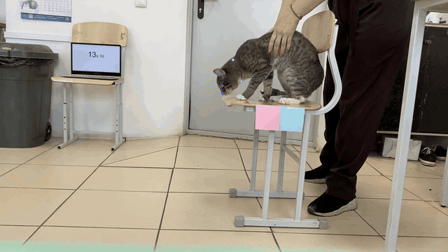

# Cat Jump Motion Analysis · Кошкоскок

**Computer vision and mathematical analysis of a cat's jump**  
*Original school research project (2023) by Margarita Trott and Irina Khlebina.*

We investigated how a cat's movement can be analyzed using video recordings, body-keypoint tracking, camera calibration, and mathematical modeling. The original project combined **Python, DeepLabCut Model Zoo, OpenCV, NumPy, and Matplotlib**.

> We used an existing DeepLabCut pose-estimation model; we did **not** train a new neural network.

## Demo: tracking a cat's jump



*Original footage recorded by Margarita Trott. Keypoint-tracking preview from the project.*

**Watch the videos:** [Original jump](media/original_jump.mp4) · [Processed jump with tracked keypoints](media/tracked_jump.mp4)

## Original experiment results

These are the **original plots from our 2023 school research**, rather than the later regenerated examples. We tracked three anatomical keypoints in separate experiments.

| Experiment 1 — Left ear | Experiment 2 — Throat | Experiment 3 — Tail |
|:---:|:---:|:---:|
|  |  |  |

**[View the complete gallery of 27 original experimental graphs](results/original/README.md)** — all three experiments, including trajectory, position, velocity, and acceleration plots. Original images are preserved without redrawing; velocity and acceleration charts are historical exploratory results with limitations described below.

The original research also included plots of positions, velocities, and accelerations. Those historical results should be treated as exploratory: the timestamp and frame associations necessary to independently verify the derived velocities and accelerations are not fully preserved in the exported dataset.

## How it worked

1. **Record the experiment.** Film a cat's jump with a stationary camera and a physical reference object.
2. **Track body keypoints.** Apply an existing DeepLabCut Model Zoo model to estimate landmark positions in successive video frames.
3. **Extract coordinates.** Select relevant observations for the left ear, throat, and tail.
4. **Calibrate the image.** Experiment with HSV color segmentation in OpenCV to identify a reference square and estimate a pixel-to-centimeter scale.
5. **Analyze and visualize.** Plot the tracked motion and explore polynomial trajectory approximations, position curves, and derived kinematic quantities.

The project included original Python scripts and a guide describing the experimental workflow.

## Reproduce the available coordinate plots

The repository includes a **later, publication-oriented analysis script** to make the saved coordinate samples easier to inspect. This is distinct from the original 2023 plotting programs, which are preserved in `legacy/`.

Python 3.10+ is recommended.

```bash
# Run from the repository root
python3 -m venv .venv
source .venv/bin/activate
python -m pip install -r requirements.txt
python src/analyze.py --data data/ear.csv --output results/ear.png --name "Left ear"
python src/analyze.py --data data/throat.csv --output results/throat.png --name "Throat"
python src/analyze.py --data data/tail.csv --output results/tail.png --name "Tail"
python -m unittest discover -s tests -v
```

The cleaned-up script plots positions from the saved **pixel-coordinate samples**. It can optionally fit a polynomial (e.g., `--degree 2`). It does not rerun DeepLabCut and **does not reconstruct velocity or acceleration** from uncertain time information.

The original experimental figures are shown above. The separately regenerated examples remain available as [ear](results/ear.png), [throat](results/throat.png), and [tail](results/tail.png) for comparison, not as replacements for the original results.

## Repository structure

```text
.
├── data/                 # Selected saved keypoint coordinates
├── src/analyze.py        # Reproducible analysis of the saved data
├── tests/                # Basic automated tests
├── results/              # Highlighted trajectories and regenerated examples
│   └── original/         # All 27 original graphs with a separate gallery README
├── media/                # GIF preview and short original/processed videos
├── legacy/               # Historical school-project Python scripts
├── docs/methodology.md   # Workflow and limitations
└── requirements.txt
```

## Limitations

- Some exported coordinate observations were filtered by confidence **without retaining the corresponding frame indices**. Row order is not a reliable time axis.
- The legacy scripts contain manually supplied time values and approximations, but these cannot all be safely matched to the retained filtered coordinates.
- The original pixel-to-centimeter calibration was not independently revalidated for every saved data extract; the reproducible script therefore uses pixel coordinates.
- Polynomial fits summarize observations and should not automatically be interpreted as physically validated motion models.

## Credits

**Original research and presentation:** Margarita Trott and Irina Khlebina.  
**Original video recordings:** Margarita Trott.  
**Pose-estimation software:** [DeepLabCut](https://github.com/DeepLabCut/DeepLabCut) (pre-existing model).

The original project code is preserved in `legacy/`. The newer `src/analyze.py` and accompanying tests were added for publication and reproducibility; they are **not** the same code as the original school research. Attribution of the jointly developed research is retained.
