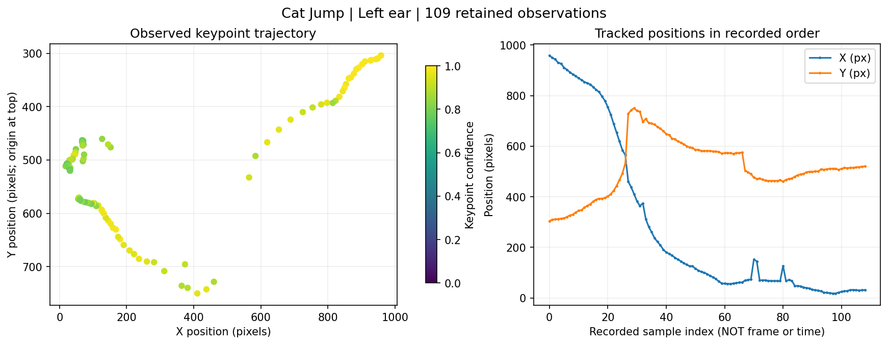
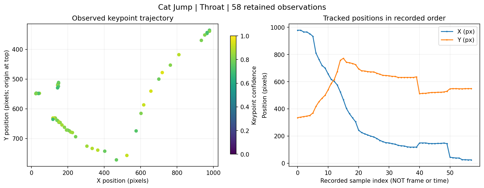
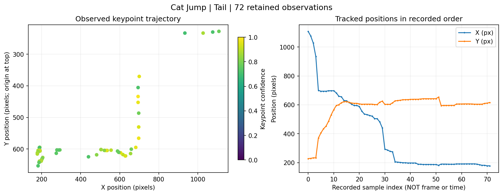

# Cat Jump Motion Analysis · Кошкоскок

**Computer vision + mathematical modeling of a cat's jump**  
*Original school research project by Margarita Trott and Irina Khlebina.*

This project explores how motion-tracking coordinates from video recordings
can be converted into visualizations of an animal's movement. The original
workflow used [DeepLabCut Model Zoo](https://github.com/DeepLabCut/DeepLabCut)
for pose estimation, OpenCV for calibration/visualization, and Python/NumPy/
Matplotlib for plotting polynomial approximations of tracked keypoints.
**The team used an existing pose-estimation model; it did not train a new neural network.**

## Preview

The following plots are regenerated directly from the retained coordinate samples.
The default plots display observations without imposing a motion model.
An optional curve fit is available for exploratory analysis, but is **not a validated physics model**.

| Left ear | Throat | Tail |
|---|---|---|
|  |  |  |

## What we built in the original project

1. Recorded a cat moving from a raised surface, with a fixed camera and a
   reference square of known physical size.
2. Used the external DeepLabCut Model Zoo to estimate body keypoint positions
   and confidence scores from video.
3. Filtered and exported coordinate observations for selected keypoints.
4. Explored HSV-based detection of the reference square in OpenCV and pixel-to-
   centimeter calibration.
5. Visualized trajectories and experimented with fitted position, velocity,
   and acceleration plots; wrote a step-by-step guide for repeating the process.

The original project included three keypoints / analyses: **left ear, throat,
and tail**. The videos, original charts, and original source scripts are
retained in the private source archive; this public-facing draft includes
only the materials needed for a small reproducible example.

## Reproduce the plotted results

Requires Python 3.10+.

```bash
python3 -m venv .venv
source .venv/bin/activate        # Windows: .venv\Scripts\activate
python -m pip install -r requirements.txt
python src/analyze.py --data data/ear.csv --output results/ear.png --name "Left ear"
python src/analyze.py --data data/throat.csv --output results/throat.png --name "Throat"
python src/analyze.py --data data/tail.csv --output results/tail.png --name "Tail"
python -m unittest discover -s tests -v
```

You may pass `--degree 2` for an **optional illustrative** polynomial fit, or
`--min-confidence 0.8` to apply an additional confidence threshold.
**No GPU or DeepLabCut installation is required** to reproduce the plots
from the included *already-extracted* keypoint observations.

## Repository contents

```text
data/                 Selected keypoint coordinates, in pixels + confidence
src/analyze.py        Reproducible visualization and descriptive curve-fitting
tests/                Minimal validation tests
results/              Generated example visualizations
legacy/               Original school-project Python scripts (historical reference)
docs/methodology.md   Limitations and original workflow details
```

## Important limitations

- **No reliable timestamps or video-frame IDs in the exported keypoint CSVs.**
  These records were confidence-filtered and the skipped frame numbers were
  not preserved. `sample_index` is just row order, **not video-frame number**.
  This demo **does not estimate velocities or accelerations** from it.
- Original scripts contained handwritten timestamp records, interactive
  keypoint ranges, and manually entered polynomial coefficients. The supplied
  timestamp files cannot be safely mapped to these filtered rows as-is.
- The approximate **13 pixels/cm** parameter occurs in the legacy scripts,
  but the calibration for each data extract was not independently verified.
  The current figures intentionally report **pixels rather than centimeters**.
- Polynomial fits can misrepresent trajectories composed of multiple motion
  phases, particularly at higher degrees. Fits are off by default; when
  enabled, RMSE is descriptive, not a measurement uncertainty bound.
- The plot script does **not** reproduce or rerun pose estimation itself.
  See the linked DeepLabCut project for the external model and original
  notebook workflow.

## Credits and provenance

Original research and presentation: **Margarita Trott and Irina Khlebina**.
The source scripts are kept in `legacy/` for reference; `src/analyze.py`
is a later publication-oriented refactor of the *exported coordinate analysis*,
not the same code as the original school project. The exact division of
original implementation work between co-authors is not recorded here.

Before releasing photos, videos, or choosing a license, confirm that both
collaborators are comfortable with the publication and attribution.
DeepLabCut is a third-party project used as part of the workflow.
